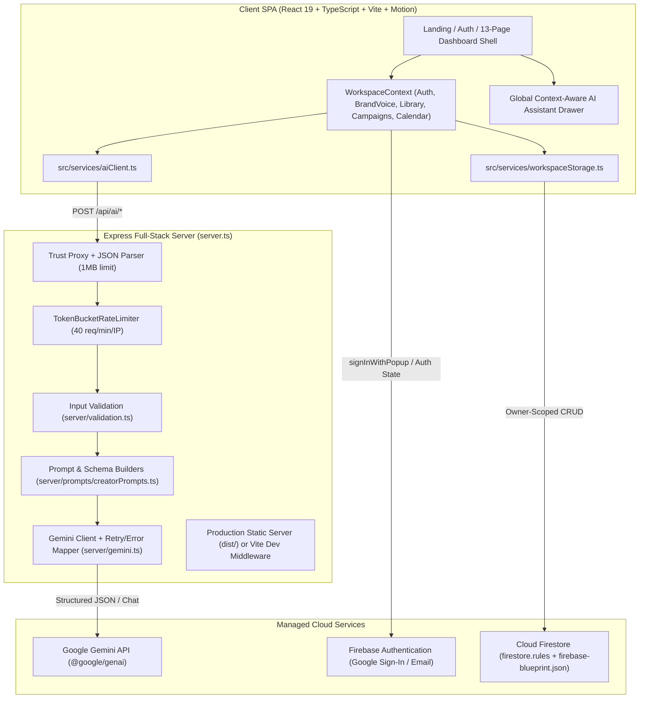
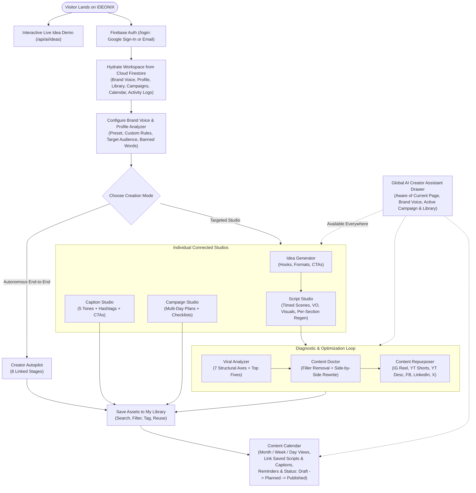
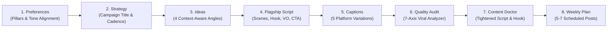

# IDEONIX — From Ideas to Impact

**IDEONIX** is a full-stack, AI-powered creator strategy and production studio that transforms a single raw idea into a complete, voice-consistent content pipeline—spanning ideation, shoot-ready scripting, multi-platform captions, cross-platform repurposing, structural viral diagnostics, copy editing, multi-day campaign planning, and publishing calendar management inside a dark Liquid Glass workspace.

---

## Table of Contents

- [The Concept & Uniqueness](#the-concept--uniqueness)
- [Full System Architecture](#full-system-architecture)
- [Full Creator Workflow Flowchart](#full-creator-workflow-flowchart)
- [8-Stage Creator Autopilot Pipeline](#8-stage-creator-autopilot-pipeline)
- [Core Studios & Capabilities](#core-studios--capabilities)
- [API Endpoints](#api-endpoints)
- [Data Model & Zero-Trust Security](#data-model--zero-trust-security)
- [Tech Stack & Project Structure](#tech-stack--project-structure)
- [Local Development & Testing](#local-development--testing)
- [Deployment (Google Cloud Run & Firebase)](#deployment-google-cloud-run--firebase)
- [Uploading to GitHub](#uploading-to-github)

---

## The Concept & Uniqueness

Most AI creator tools operate as isolated prompt boxes: you generate an idea in one chat, write a script in another, lose your tone in a third, and manage schedules in an external spreadsheet. **IDEONIX solves creative fragmentation through five architectural differentiators:**

1. **Unified Brand Voice Injection Across Every Call**
   - Creators define their voice once in **Brand Voice** (choosing from 8 presets—`Cinematic`, `Professional`, `Funny`, `Minimal`, `Educational`, `Storytelling`, `Bold`, `Friendly`—plus custom voice rules, target audience, and banned words).
   - Every backend prompt builder (`formatBrandVoiceContext`) automatically injects this configuration into all AI endpoints so ideas, scripts, captions, repurposed posts, critiques, and assistant replies stay on-brand.

2. **Sequential Context-Chaining Autopilot**
   - Instead of one-shot monolithic output, **Creator Autopilot** executes an 8-stage stateful pipeline where each step consumes structured JSON from prior steps—and lets the creator **regenerate any single stage** without restarting the pipeline.

3. **Closed-Loop Quality & Editing Cycle**
   - Drafts flow directly from **Script Studio** into **Viral Analyzer** (7-axis structural scoring) and **Content Doctor** (filler removal + side-by-side Original vs. Improved diffing), then onward to **Content Repurposer** (6 native platform formats) and **Content Calendar**.

4. **Honest, Non-Fabricated Diagnostics**
   - **Viral Analyzer** explicitly frames scores as structural editorial estimates (*"AI-generated estimate, not a prediction or guarantee of virality."*).
   - **Creator Profile Analyzer** evaluates positioning and writing cadence strictly from provided bio and sample captions without inventing follower counts or impressions.
   - **Content Calendar** focuses on scheduling, reminders, and linking saved scripts/captions across `Draft`, `Planned`, and `Published` states rather than claiming external auto-publishing.

5. **Server-Side AI Gateway & Zero-Trust Cloud Persistence**
   - All `@google/genai` calls execute strictly on the Node.js/Express server (`GEMINI_API_KEY` never reaches the browser), enforced with schema-typed JSON responses (`responseSchema`), input validation, and per-IP token-bucket rate limiting.
   - User workspaces persist in Cloud Firestore under owner-only, email-verified, schema-validated `firestore.rules`.

---

## Full System Architecture



---

## Full Creator Workflow Flowchart



---

## 8-Stage Creator Autopilot Pipeline

Creator Autopilot chains context forward through each stage and persists the completed run to **My Library** and **Content Calendar**:



Every individual step supports **single-step regeneration** so creators can iterate on a script, caption set, or quality fix without losing prior context.

---

## Core Studios & Capabilities

| Module | Route / Page ID | Purpose |
| :--- | :--- | :--- |
| **Overview** | `overview` | Workspace metrics, 7-day generation activity chart, active campaigns, and upcoming calendar reminders |
| **Creator Autopilot** | `autopilot` | 8-stage sequential AI pipeline with per-step regeneration and one-click Library/Calendar export |
| **Idea Generator** | `ideas` | Niche, topic, audience, platform, style, language, and count controls with inline editing & save |
| **Script Studio** | `scripts` | Full spoken script, timed scene breakdowns, voiceover/visual/transition cues, and per-section regeneration |
| **Caption Studio** | `captions` | Generates `Engaging`, `Short`, `Professional`, `Funny`, and `Emotional` variations with hashtags and CTAs |
| **Content Repurposer** | `repurposer` | Adapts one source draft into Instagram Reel, YouTube Shorts, YouTube Description, Facebook, LinkedIn, and X |
| **Viral Analyzer** | `viral` | Scores 7 dimensions (`Hook Strength`, `Relevance`, `Clarity`, `Engagement`, `Storytelling`, `CTA`, `Structure`) with fixes |
| **Content Doctor** | `doctor` | Flags filler wording and weak sections with side-by-side Original vs. Improved editor |
| **Campaign Studio** | `campaigns` | Multi-day campaign plans with daily outlines, toggleable production checklists, and status tracking |
| **Content Calendar** | `calendar` | Month, Week, and Day calendar views with Draft/Planned/Published status, reminders, and linked scripts/captions |
| **My Library** | `library` | Categorized, searchable archive of all saved outputs across every studio |
| **Brand Voice** | `brand-voice` | Voice presets, custom guidelines, banned words, and Creator Profile positioning analyzer |
| **Settings** | `settings` | Account status, email verification controls, workspace JSON export, and session management |
| **Global AI Assistant** | `AssistantDrawer` | Context-aware drawer available on every dashboard page with Copy and Save to Library actions |

---

## API Endpoints

All AI generation is routed through Express endpoints in `server.ts` with token-bucket rate limiting (`40` requests/minute/IP) and strict request validation:

| Method & Path | Description |
| :--- | :--- |
| `GET /api/health` | Service health check and `aiConfigured` status |
| `POST /api/ai/ideas` | Generate structured content ideas |
| `POST /api/ai/script` | Generate full shoot-ready script or regenerate a single section |
| `POST /api/ai/captions` | Generate 5-tone caption variations with hashtags and CTAs |
| `POST /api/ai/repurpose` | Repurpose a draft into 6 platform-native formats |
| `POST /api/ai/viral-analyze` | 7-axis structural quality analysis with disclaimer |
| `POST /api/ai/content-doctor` | Filler detection and side-by-side copy improvements |
| `POST /api/ai/campaign` | Multi-day campaign plan and production checklist |
| `POST /api/ai/autopilot/step` | Execute or regenerate an individual Creator Autopilot stage |
| `POST /api/ai/profile-analyze` | Positioning and writing-style audit from creator samples |
| `POST /api/ai/assistant` | Context-aware conversational assistant reply |

---

## Data Model & Zero-Trust Security

Firestore collections are formally defined in `firebase-blueprint.json`, tested in `security_spec.md`, and enforced by `firestore.rules`:

- `/users/{userId}` — Owner-only user profile, `brandVoice`, and `creatorProfile` snapshot
- `/libraryItems/{itemId}` — Saved outputs across all studios (`idea`, `script`, `caption`, `repurpose`, `campaign`, `autopilot`, `viral`, `doctor`, `assistant`)
- `/campaigns/{campaignId}` — Structured multi-day campaigns with terminal state protection once `Completed`
- `/calendarEntries/{entryId}` — Scheduled slots with linked script/caption references and terminal state protection once `Published`
- `/activityLogs/{logId}` — Immutable generation logs powering the 7-day overview activity chart

Security highlights:
- Strict field allowlists (`hasAll` / `hasOnly`), bounded string/array sizes, and regex-validated IDs (`^[a-zA-Z0-9_-]+$`).
- Server-timestamp integrity checks (`request.time`) and `request.auth.token.email_verified == true` enforcement on writes.
- Owner-scoped `get` and `list` rules (`resource.data.userId == request.auth.uid`) with no blanket reads.

---

## Tech Stack & Project Structure

- **Frontend**: React 19, TypeScript, Vite 8, Tailwind CSS v4, Motion (`motion/react`), Lucide React
- **Backend**: Node.js 22, Express 4, `@google/genai` (server-side only)
- **Auth & Persistence**: Firebase Authentication & Cloud Firestore

```text
├── server.ts                          # Express app, AI API routes, Cloud Run static/Vite serving & graceful shutdown
├── server/
│   ├── gemini.ts                      # @google/genai client, structured JSON output, retries & error mapping
│   ├── rateLimit.ts                   # Per-IP token-bucket rate limiter
│   ├── validation.ts                  # Request payload validation helpers
│   └── prompts/creatorPrompts.ts      # Brand-voice-aware prompt & responseSchema definitions
├── src/
│   ├── App.tsx                        # Root router & Liquid Glass SVG filter setup
│   ├── config/
│   │   ├── firebase.ts                # Firebase App, Auth, Firestore initialization & error formatter
│   │   └── motion.ts                  # Motion duration/easing tokens & reduced-motion helpers
│   ├── context/WorkspaceContext.tsx   # Global auth & Firestore-synced workspace state
│   ├── services/
│   │   ├── aiClient.ts                # Typed frontend client for /api/ai/*
│   │   └── workspaceStorage.ts        # Firestore CRUD & defensive payload sanitization
│   ├── components/
│   │   ├── layout/                    # DashboardShell, AssistantDrawer, sidebarMotion
│   │   └── ui/                        # GlassPrimitives, GlassSelect, LegalModal, WaveCanvasBackground
│   ├── pages/
│   │   ├── LandingPage.tsx            # Public landing page with live interactive idea demo
│   │   ├── LoginPage.tsx              # Google Sign-In & Email authentication
│   │   └── dashboard/                 # 13 connected creator studio pages
│   ├── types/ideonix.ts               # Shared TypeScript domain models
│   └── utils/creatorHelpers.ts        # Date grids, activity aggregation, filtering & auth error mapping
├── firebase-applet-config.json        # Provisioned Firebase client configuration
├── firebase-blueprint.json            # Firestore entity & collection schema blueprint
├── firestore.rules                    # Hardened Firestore security rules
├── security_spec.md                   # Security invariants & adversarial test spec
├── metadata.json                      # App metadata & server-side Gemini capability declaration
├── vite.config.ts                     # Vite build & preview server configuration
└── .env.example                       # Environment variable template (no secrets)
```

---

## Local Development & Testing

### Prerequisites
- **Node.js 22+** and **npm**
- A **Gemini API key** (`GEMINI_API_KEY`)
- A **Firebase project** with Firestore and Authentication enabled (pre-wired in `firebase-applet-config.json`)

### Setup & Run
1. Install dependencies:
   ```bash
   npm install
   ```
2. Create your local environment file from `.env.example`:
   ```bash
   cp .env.example .env
   ```
   Set `GEMINI_API_KEY` inside `.env`.
3. Start the full-stack development server on port `3000`:
   ```bash
   npm run dev
   ```
4. Run unit tests, TypeScript checks, and production build:
   ```bash
   npx tsx --test src/utils/creatorHelpers.test.ts src/config/motion.test.ts src/components/layout/sidebarMotion.test.ts
   npm run lint
   npm run build
   ```
5. Preview the production build locally:
   ```bash
   NODE_ENV=production npm run start
   ```

---

## Deployment (Google Cloud Run & Firebase)

### Deploying from Google AI Studio to Cloud Run
This repository is pre-configured for Google AI Studio's one-click **Deploy to Cloud Run**:
- **Build command**: `npm run build` (outputs optimized client assets into `dist/`)
- **Start command**: `npm run start` (`node server.ts` on `0.0.0.0:${PORT || 3000}`)
- **Production runtime detection**: Automatically serves `dist/` when `NODE_ENV=production` or `K_SERVICE` (Cloud Run) is set, with `trust proxy` enabled, `Cache-Control: no-cache` on HTML responses, `/api/*` JSON 404 guards, and graceful `SIGTERM` shutdown.
- **Environment variables / secrets**: Configure `GEMINI_API_KEY` in Cloud Run / AI Studio Secrets (automatically linked via `metadata.json` `MAJOR_CAPABILITY_SERVER_SIDE_GEMINI_API`).

### Firebase Console Checklist
1. **Authentication > Sign-in method**:
   - **Google** provider is enabled by default.
   - Optionally enable **Email/Password** if you want users to register/sign in with email and password.
2. **Authentication > Settings > Authorized domains**:
   - Confirm `localhost` and your deployed `*.run.app` domain are listed.
3. **Firestore Rules**:
   - Review and deploy `firestore.rules` to your Firestore database before sharing broadly.

---

## Uploading to GitHub

`.gitignore` excludes `node_modules/`, `dist/`, `build/`, `.env*` (while keeping `.env.example`), `*.log`, `.DS_Store`, `.playwright-cli/`, `.firebase/`, and `bun.lock` so no secrets or build artifacts are committed.

```bash
git init
git add .
git commit -m "Initial commit: IDEONIX creator workspace"
git branch -M main
git remote add origin https://github.com/<your-username>/<your-repo>.git
git push -u origin main
```
